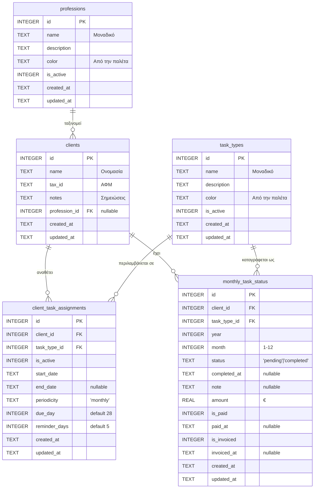

# Η βάση δεδομένων

Ένα αρχείο SQLite, στο `%APPDATA%\com.ariston.accountant-util\accountant.db`, σε
λειτουργία WAL. Έξι πίνακες, περίπου 52 KB.

Το παρακάτω είναι διαβασμένο από το **ζωντανό** αρχείο, όχι από τις δηλώσεις.

## Διάγραμμα



Η ίδια σχέση σε απλό κείμενο:

```
                    ┌──────────────┐
                    │  professions  │  Επάγγελμα πελάτη
                    └──────┬───────┘
                           │ profession_id (nullable)
                           ▼
  ┌───────────┐   client_id   ┌────────────────────────┐
  │  clients  │──────────────▶│ client_task_assignments│◀── Ο κανόνας της
  │  Πελάτης  │               │  Ποιος κάνει τι,       │    εργασίας: από
  └─────┬─────┘               │  πότε, πότε λήγει      │    πότε, πότε
        │                     └────────────────────────┘
        │  ┌────────────┐
        ├──▶ task_types │  Βασική εργασία (ΦΠΑ, ΜΙΣΘΟΔΟΣΙΑ, …)
        │  └──────┬─────┘
        │         │
        │  ┌──────▼─────────────────────────┐
        └──▶  monthly_task_status           │  Τι έγινε τον Οκτώβριο:
           │  Ολοκληρώθηκε; Πληρώθηκε;     │  κατάσταση, ποσό, είσπραξη,
           │  Τιμολογήθηκε; Πόσο;         │  τιμολόγιο, σημείωση
           └────────────────────────────────┘
```

## Τι αποθηκεύεται

**`clients`** — 46 γραμμές. Όνομα, ΑΦΜ, ελεύθερες σημειώσεις και το επάγγελμα.
Το `profession_id` είναι **nullable**: ο πελάτης μπορεί να μην είναι ταξινομημένος,
και το φίλτρο επαγγέλματος δεν τον περιλαμβάνει.

**`task_types`** — 23 γραμμές. Οι βασικές εργασίες (ΦΠΑ, ΕΝΦΚΑ, ΜΙΣΘΟΔΟΣΙΑ, …) με
χρώμα για το σημείο δίπλα στο όνομα και σημαία ενεργό/ανενεργό.

**`professions`** — 7 γραμμές. Τα επαγγέλματα, με τη δική τους παλέτα χρωμάτων.
Καλλιεργούνται αυτόματα στην πρώτη εκτέλεση και μετά προστίθενται μόνο όσα
λείπουν.

**`client_task_assignments`** — 18 γραμμές. **Ο κανόνας της εργασίας**: «ο πελάτης
X κάνει την εργασία Y από την ημερομηνία Z, κάθε μήνα, λήγει στις 28, υπενθύμιση
5 μέρες πριν». Εδώ γεννιούνται οι εργασίες κάθε μήνα.

**`monthly_task_status`** — 47 γραμμές. **Τι πράγματι έγινε** σε έναν συγκεκριμένο
μήνα: ολοκληρώθηκε ή όχι και πότε, το ποσό, αν πληρώθηκε και πότε, αν
τιμολογήθηκε και πότε, και μια σημείωση. Μοναδικό το (πελάτης, εργασία, έτος, μήνας)
— δηλαδή δεν υπάρχουν δύο γραμμές για την ίδια εργασία τον ίδιο μήνα.

**`task_reminders`** — **δεν υπάρχει πια.** Ήταν ένας πίνακας με 0 γραμμές που δεν
γραφότανε ποτέ: οι υπενθυμίσεις υπολογίζονται κάθε φορά από τις αναθέσεις
(`domain/recurrence.ts`), οπότε αποθήκευση δεν χρειαζόταν. Η πρώτη εκτέλεση μετά
από αυτή την αλλαγή τον σβήνει από τη δική σου βάση. Τα παλιά αντίγραφα
ασφαλείας που τον έχουν ακόμη επαναφέρονται κανονικά — ο πίνακας απλώς
αγνοείται.

## Τι δεν αποθηκεύεται

- **Το φίλτρο.** Δεν περνάει στη βάση — είναι παράγωγο, φιλτραρισμός στη μνήμη
  πάνω στις γραμμές του μήνα. Γι' αυτό δεν «κολλάει» ανάμεσα σε συνεδρίες: το ίδιο
  μήνα ανοίγει κάθε φορά με ό,τι έχεις επιλέξει εκείνη τη στιγμή.
- **Τα ποσά σε κεντ.** Ένα `amount` όπως το βλέπει ο χρήστης. Το `money.ts` κάνει
  στρογγυλοποίηση σε λεπτά, οπότε δεν αποθηκεύεται ποτέ `0.145`.
- **Το μήνας που βλέπεις.** Οι ημερομηνίες στα `created_at` είναι UTC από τη SQLite.

## Σχέσεις και διαγραφές

Ένας πελάτης που διαγράφεται σβήνει και τις αναθέσεις του και τις μηνιαίες
καταστάσεις του (`ON DELETE CASCADE`). Ένας επαγγελματικός **όχι** — η στήλη
`profession_id` δεν έχει κανόννα, και το repository καθαρίζει πρώτα τους πελάτες
πριν το διαγράψει. Χωρίς αυτό, ένας πελάτης θα κρατούσε id προς μη υπάρχον.

Το `foreign_keys` είναι **ενεργοποιημένο** σε αυτή τη σύνδεση, οπότε η βάση
επιβάλλει τους κανόνες μόνη της.

## Μετανάστευση

Ο σχήμα χτίζεται από τη λίστα `MIGRATIONS` στο `src/hooks/useDatabase.ts`, που
τρέχει σε κάθε εκκίνηση. Οι δηλώσεις `ALTER TABLE ... ADD COLUMN` παραλείπονται
σιωπηλά όταν η στήλη υπάρχει ήδη, οπότε μια υπάρχουσα βάση αναβαθμίζεται επί τόπου.
Μετά τις μεταναστεύσεις μπαίνουν τα προεπιλεγμένα επαγγέλματα, μόνο όσα
λείπουν.

## Αντίγραφα

Το «Αντιγραφή ασφαλείας» γράφει ένα **ολόκληρο αρχείο** με `VACUUM INTO` — ένα
αυτοτελές αντίγραφο, όχι αντίγραφο του `.db` (που σε WAL θα άφηνε πίσω ό,τι
δεν έχει γραφτεί ακόμα). Η επαναφορά διαβάζει πίσω τους πίνακες, με τη σειρά
των εξαρτήσεων, και καθαρίζει πρώτα ανάποδα.

Το ίδιο αρχείο, μετά από δύο αντίγραφα:

```
%APPDATA%\com.ariston.accountant-util\
    accountant.db          52 KB   η ζωντανή
    accountant.db-shm      32 KB   προσωρινά, από το WAL
    accountant.db-wal       0 KB
    backup-prenetto-2026-09.db  44 KB
```

Μπορείς να το δεις με οποιοδήποτε SQLite browser. Η εφαρμογή έχει και
«Αντίγραφο ασφαλείας» / «Επαναφορά από αντιγράφου» στο μενού «Αρχείο».
